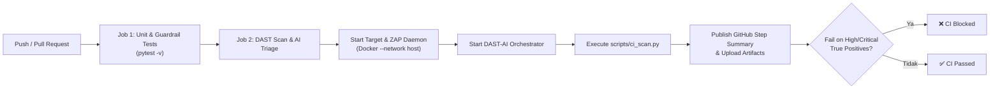

# DAST-AI

Sistem orkestrasi DAST (*Dynamic Application Security Testing*) berbasis **OWASP ZAP** dan **LLM (Claude / Anthropic)** menggunakan FastAPI. Sistem ini memetakan endpoint target, melakukan active scanning terkontrol, membersihkan temuan dari data rahasia (*secret sanitization*), dan menggunakan LLM untuk melakukan triase temuan serta meminimalkan *false positive*.

---

## Fitur & Guardrails Keamanan
- **Target Allowlist**: Hanya target yang terdaftar di `ALLOWED_HOSTS` yang dapat dipindai.
- **Private IP Restriction**: Secara default (`REQUIRE_PRIVATE_IP=true`), scanning ke IP publik dicegah untuk menghindari pengujian tidak sengaja ke luar sistem lokal/staging.
- **Data Sanitization**: Token JWT, Bearer token, API key, password, dan email dibersihkan secara otomatis sebelum dikirim ke LLM.
- **Scan Throttling & Protected Scope**: Pengaturan rate limit scan dan pengecualian endpoint destruktif (seperti logout, delete, destroy, reset-db).

---

## Prasyarat
- Python 3.10+
- OWASP ZAP (versi 2.14+ disarankan)
- API Key Anthropic (untuk LLM triage)

---

## Panduan Menjalankan

### Opsi 1: Tanpa Docker (Virtualenv)

#### 1. Setup Virtual Environment & Dependencies
Buka terminal di root direktori proyek:

**Windows (PowerShell):**
```powershell
python -m venv .venv
.\.venv\Scripts\Activate.ps1
pip install -r requirements.txt pytest
```

**Linux / macOS:**
```bash
python3 -m venv .venv
source .venv/bin/activate
pip install -r requirements.txt pytest
```

#### 2. Konfigurasi Environment File
Salin file template `.env.example` menjadi `.env`:
```bash
cp .env.example .env
```
Sesuaikan isi file `.env`:
```ini
ENVIRONMENT=staging
ALLOWED_HOSTS=["localhost", "127.0.0.1"]
REQUIRE_PRIVATE_IP=true
ZAP_URL=http://localhost:8090
ZAP_API_KEY=kunci-api-zap-anda
LLM_API_KEY=sk-ant-api-key-anda
LLM_MODEL=claude-sonnet-5-5
THREADS_PER_HOST=2
DELAY_MS=200
MAX_SPIDER_MINUTES=5
MAX_SCAN_MINUTES=20
```

#### 3. Jalankan OWASP ZAP di Host (Daemon Mode)
Jalankan daemon ZAP pada port 8090 dengan API key yang sesuai dengan konfigurasi di atas:

**Windows:**
```powershell
zap.bat -daemon -port 8090 -config api.key=kunci-api-zap-anda
```

**Linux / macOS:**
```bash
zap.sh -daemon -port 8090 -config api.key=kunci-api-zap-anda
```

#### 4. Jalankan FastAPI Orchestrator
Jalankan server uvicorn:
```bash
uvicorn app.main:app --host 127.0.0.1 --port 8000 --reload
```
Aplikasi akan aktif di `http://127.0.0.1:8000` dan dokumentasi API interaktif dapat diakses di `http://127.0.0.1:8000/docs`.

---

### Opsi 2: Menggunakan Docker Compose

Jika ingin menjalankan ZAP dan orchestrator di dalam container Docker:

1. Buat file `.env`:
   ```bash
   cp .env.example .env
   ```
   *(Pastikan `ZAP_URL=http://zap:8090` dan sesuaikan `ALLOWED_HOSTS` seperti `["host.docker.internal"]`)*

2. Jalankan docker compose:
   ```bash
   docker compose up --build
   ```

---

## Menjalankan Pengujian (Testing)

Proyek ini dilengkapi dengan unit test untuk memverifikasi guardrails keamanan dan fungsi pembersihan sanitasi data:

```bash
pytest -v
```

Semua pengujian berjalan secara offline dan mandiri tanpa mengirim traffic ke target eksternal.

---

## Cara Penggunaan API

### 1. Memulai Pemindaian Target (Trigger Scan)
Kirim permintaan POST ke endpoint `/scans` (target **harus** sudah terdaftar di `ALLOWED_HOSTS`):

```bash
curl -X POST http://localhost:8000/scans \
  -H "Content-Type: application/json" \
  -d '{
    "target_url": "http://127.0.0.1:3000",
    "framework": "node-express"
  }'
```

Response (HTTP 202 Accepted):
```json
{
  "scan_id": "a1b2c3d4e5f6",
  "state": "queued",
  "error": null,
  "report": null
}
```

### 2. Memeriksa Status & Hasil Laporan
Gunakan `scan_id` yang didapat untuk melihat status pemindaian (`scanning`, `analyzing`, atau `done`):

```bash
curl http://localhost:8000/scans/a1b2c3d4e5f6
```

Saat selesai (`done`), field `report` akan berisi total alert terdeteksi, ringkasan triase (*true positive*, *false positive*, *needs review*), serta detail setiap temuan beserta rekomendasi patch perbaikan kodenya.

---

## Integrasi CI/CD (GitHub Actions)

DAST-AI dilengkapi dengan integrasi **GitHub Actions** (`.github/workflows/dast-ci.yml`) dan CLI runner otomatis (`scripts/ci_scan.py`) untuk memindai aplikasi web secara otomatis setiap kali ada `push` atau `pull request`.

### 1. Konfigurasi Repository Secrets di GitHub

Untuk mengaktifkan triase AI menggunakan Anthropic Claude di pipeline GitHub Actions:
1. Masuk ke repositori GitHub Anda: **Settings** > **Secrets and variables** > **Actions**.
2. Klik tombol **New repository secret**.
3. Buat secret baru:
   - **Name**: `LLM_API_KEY`
   - **Value**: Masukkan Anthropic API key Anda (`sk-ant-...`).

*(Catatan: Jika `LLM_API_KEY` belum disetel atau pada PR eksternal, sistem secara otomatis beralih ke mode rule-based triage fallback tanpa membatalkan pengujian).*

### 2. Alur Kerja Pipeline CI/CD

Pipeline GitHub Actions terdiri dari 2 tahapan (jobs):



1. **Job 1: `unit-tests`**
   - Menjalankan seluruh pengujian offline (`pytest -v`).
   - Memastikan guardrail target allowlist, pembatasan private IP, dan pembersihan secret (JWT, bearer token, API key) berjalan 100% sebelum traffic scan ditembakkan.

2. **Job 2: `dast-scan`**
   - Menjalankan container daemon OWASP ZAP via Docker (`--network host`).
   - Menjalankan server DAST-AI Orchestrator di `http://127.0.0.1:8000`.
   - Menjalankan CLI Runner `scripts/ci_scan.py` untuk menguji target secara menyeluruh.
   - Mengunggah artefak laporan `dast-report.json` dan `dast-report.md`.
   - Menampilkan ringkasan visual langsung di **GitHub Actions Step Summary**.

### 3. CLI Runner Mandiri (`scripts/ci_scan.py`)

Anda juga dapat menjalankan skrip scanner CI secara mandiri di server lokal atau pipeline CI lain (GitLab CI, Bitbucket Pipelines, Jenkins):

```bash
python scripts/ci_scan.py \
  --target-url "http://127.0.0.1:8081" \
  --framework "fastapi" \
  --api-url "http://127.0.0.1:8000" \
  --fail-on "high" \
  --output-json "dast-report.json" \
  --output-md "dast-report.md"
```

**Daftar Parameter `scripts/ci_scan.py`:**
| Opsi | Default | Keterangan |
| :--- | :--- | :--- |
| `--target-url` | *(wajib)* | URL target yang akan dipindai (harus terdaftar di `ALLOWED_HOSTS`). |
| `--framework` | `unknown` | Framework aplikasi target (`fastapi`, `node-express`, `laravel`, dll.). |
| `--api-url` | `http://127.0.0.1:8000` | Alamat DAST-AI Orchestrator API. |
| `--scan-mode` | `passive` | Mode scan: `passive` (aman tanpa fuzzing/attack), `active`, atau `full`. |
| `--vercel-bypass-secret` | `""` | Secret token untuk bypass Vercel Deployment Protection (`x-vercel-protection-bypass`). |
| `--header` | `[]` | Header HTTP kustom (`Key: Value`). Dapat dipanggil berulang kali. |
| `--fail-on` | `high` | Ambang batas keparahan untuk menghentikan CI (`critical`, `high`, `medium`, `any`, `none`). |
| `--timeout` | `600` | Batas waktu maksimal pemindaian (detik). |
| `--poll-interval` | `5` | Interval pengecekan status (detik). |
| `--wait-ready` | `60` | Waktu tunggu hingga Orchestrator siap menerima request. |
| `--output-json` | `""` | Path penyimpanan file laporan JSON. |
| `--output-md` | `""` | Path penyimpanan file laporan Markdown. |

### 4. Panduan Memindai Vercel Preview (Deployment Protection)

Jika target Anda adalah aplikasi Vercel Preview (seperti DesignLogV2) yang dilindungi oleh Vercel Deployment Protection:

1. **Dapatkan Bypass Secret dari Vercel Dashboard:**
   - Buka project di **Vercel** > **Settings** > **Deployment Protection**.
   - Di bagian **Protection Bypass for Automation**, salin secret token bypass.
2. **Konfigurasi Scope & Allowlist Aman di `.env` DAST-AI:**
   ```ini
   ENVIRONMENT=staging
   ALLOWED_HOSTS=["design-log-ruby.vercel.app", "design-log-*.vercel.app"]
   REQUIRE_PRIVATE_IP=false
   VERCEL_BYPASS_SECRET=secret-bypass-dari-vercel
   ```
3. **Jalankan Passive Scan Terlebih Dahulu:**
   ```bash
   python scripts/ci_scan.py \
     --target-url "https://design-log-ruby.vercel.app" \
     --framework "react-vite" \
     --scan-mode "passive" \
     --vercel-bypass-secret "secret-bypass-dari-vercel"
   ```
   *Mode `passive` hanya memetakan endpoint dan menganalisis security headers, cookie flags, CSP, dan kebocoran informasi tanpa mengirim payload fuzzing atau request destruktif ke database production/staging.*

### 5. Menjalankan Scan Manual (Workflow Dispatch)

Anda dapat memicu pemindaian kapan saja langsung dari tab **Actions** di GitHub:
1. Buka tab **Actions** di repositori GitHub.
2. Pilih workflow **DAST-AI Security Pipeline** di panel kiri.
3. Klik dropdown **Run workflow**.
4. Isi parameter:
   - **Target URL**: URL aplikasi staging/preview yang ingin dipindai.
   - **Target Framework**: Framework target (`react-vite`, `fastapi`, dll.).
   - **Fail-On Threshold**: Ambang toleransi keparahan (`high`, `critical`, dll.).
5. Klik **Run workflow**. Laporan lengkap dan saran patch keamanan akan langsung tampil setelah scan selesai!


